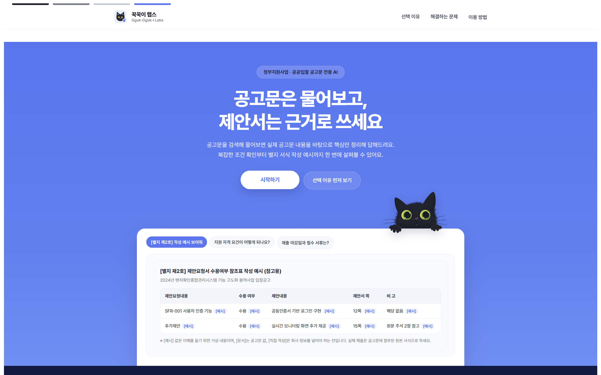
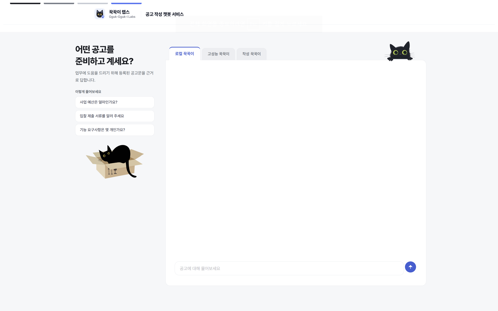
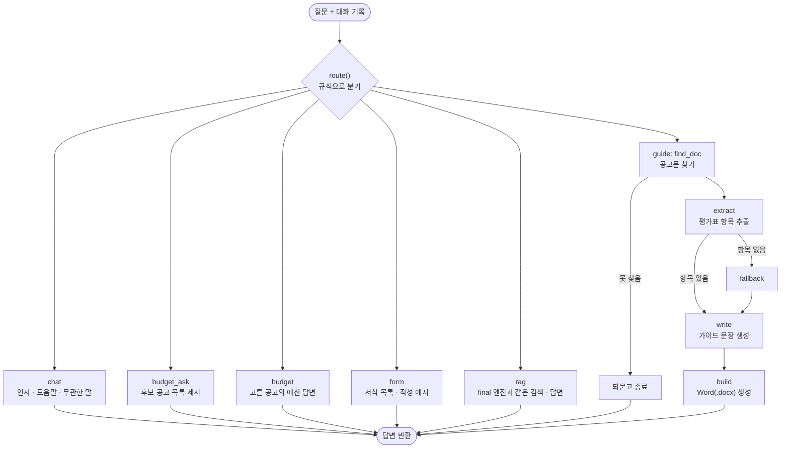

# 입찰메이트

공공 입찰 공고문(RFP)에 질문하면 공고 내용을 근거로 답하는 RAG 시스템입니다. (코드잇 AI 엔지니어 과정 중급 프로젝트)
B2G 입찰지원 컨설팅 스타트업 '입찰메이트'의 사내 도구를 가정했습니다.

- **입력**: 컨설턴트의 질문 (후속 질문 포함)
- **출력**: 공고 원문에 근거한 답변. 공고에 없는 내용은 정보가 없다고 답합니다.
- **데이터**: 공고 문서 100건 (HWP 96, PDF 4). 본문이 같은 2쌍을 합쳐 98건을 색인했습니다.
- **평가**: 골든셋 v2.2(74문항)로 단계별 실험을 하고, 정비한 v2.4(73문항)로 최종 성능을 검증했습니다. LLM 채점(gpt-5-nano)을 사용했습니다.
- **팀**: 꾹꾹이 랩스(6명) / 2026.11.09 ~ 11.30
- **최종 결과**: 정답률 **91.8%** · 환각률 **2.7%** · 거절 성공률 **100%** · 평균 응답 **1.83초** (고도화 + gpt-6-luna(low), v2.4 73문항 오타 포함 버전. 자세한 내용은 [실험 과정](#실험-과정))

실험 과정 · 분석 · 결론은 [최종 보고서(PDF)](docs/part3_2_ggukgguki_labs_report.pdf)에 정리되어 있습니다.




## 팀

<div>

### [꾹꾹이 랩스🐈‍⬛](https://app.notion.com/p/Part3-2-40f77fa64f7f80f1bf9bc40b38dfc75f)

|  |  |  |  |  |  |
|:---:|:---:|:---:|:---:|:---:|:---:|
| **[서동현](https://github.com/headache404)** | **[김건](https://github.com/9enius9un)** | **[김라희](https://github.com/KIMRAHUI)** | **[김주희](https://github.com/juhee4839)** | **[신재민](https://github.com/soul8327)** | **[이주엽](https://github.com/jylee10279)** |
| 팀장 · 리드 · 속도 개선 | Baseline · 모델 비교 | 엔진 고도화 · 작성 도우미 | 오타 강건성 · 프론트 | 청킹 · 검색 실험 | 백엔드 · 배포 |

</div>

| 이름 | 주요 작업 | 개발 일지 |
|---|---|---|
| 서동현 | Top-K 비교, 단계별 지연 분석, 프롬프트 개선, 워밍업 순서 | [📝](https://app.notion.com/p/40f77fa64f7f803db89ffc7206703cc3?source=copy_link) |
| 김건 | 초기 Baseline 구축, 임베딩 6종과 로컬 · 클라우드 답변 모델 비교, v2.4 재검증 | [📝](https://app.notion.com/p/40f77fa64f7f802c998fd9670e7efa66?source=copy_link) |
| 김라희 | 베이스라인 엔진 개선과 실험 (프롬프트 · 창 크기, 다중 사업 검색, 후보 수, 거절 문구, 금액 단위), 작성 도우미, 프론트 작업 | [📝](https://app.notion.com/p/40f77fa64f7f80d29398f9eef19d229a?source=copy_link) |
| 김주희 | 오타 강건성 실험, 평가 지표 계획, 프론트 디자인 | [📝](https://app.notion.com/p/40f77fa64f7f8051acddfd0718139e6d?source=copy_link) |
| 신재민 | 청크 크기 · 오버랩, 청킹과 검색 방식(Dense / BM25 / Hybrid) 비교, 골든셋 점검 | [📝](https://app.notion.com/p/40f77fa64f7f80418065d1c7eef28a33?source=copy_link) |
| 이주엽 | FastAPI 백엔드와 인증, 엔진 연결, Docker Compose, GCP VM 배포, Readme 작성 | [📝](https://app.notion.com/p/40f77fa64f7f808c9718c92bb7b3d518?source=copy_link) |


## 목차

- [시스템 구조](#시스템-구조)
- [엔진](#엔진)
- [기술 스택](#기술-스택)
- [데이터](#데이터)
- [실험](#실험)
- [사전 준비](#사전-준비)
- [실행](#실행)
- [파일 구조](#파일-구조)
- [백엔드 API](#백엔드-api)
- [엔진 추가](#엔진-추가)
- [평가](#평가)
- [보고서 · 발표 자료](#보고서--발표-자료)


## 시스템 구조


### 디렉토리 구조

| 경로 | 역할 |
|---|---|
| `backend/` | FastAPI 서버 (라우터, 서비스, 스키마, 설정) |
| `engines/` | RAG 엔진 구현 (`final`, `local_final`, `final_writer`) |
| `frontend.py` | Gradio 채팅 화면 |
| `ai/data_basic/` | 데이터 파이프라인 (문서 변환, OCR, 전처리, EDA, 청킹·임베딩·재순위 비교, 골든셋 점검) |
| `scripts/typo/` | 오타 강건성 실험 |
| `common/` | 실험 기록 (구글 시트 연동) |
| `data/` | 공고 문서와 골든셋 (저장소 제외, 비밀유지) |
| `indexes/` | 벡터 인덱스 (저장소 제외, 자동 생성) |
| `outputs/` | 평가 결과 (저장소 제외) |
| `compose.yaml` | 컨테이너 구성 |


## 엔진
| engine_id | 이름 | 설명 |
|---|---|---|
| `local_final` | 로컬 꾹꾹이 | Ollama 로컬 모델(gemma4:e2b) 답변 |
| `final` | 고성능 꾹꾹이 | OpenAI gpt-6-luna 답변 |
| `final_writer` | 작성 꾹꾹이 | 가이드 · 서식 · 검색 답변, Word 문서 생성 |

### Workflow

각 엔진의 질문 처리 흐름을 보여줍니다. `final`과 `local_final` 엔진은 동일한 파이프라인이고, 답변 모델만 다릅니다.

<details>
<summary>final · local_final</summary>

두 엔진은 같은 파이프라인이고, 답변 모델과 실행 위치(provider)만 다릅니다.


- LangGraph로 만든 고정 파이프라인(retrieve → generate)입니다. 모델이 검색 도구를 직접 호출하는 에이전트 방식도 같은 질문으로 비교했고, 이번 데이터에서는 고정 파이프라인의 정답률이 더 높았습니다. (78.4% / 71.6%)
- 청크 앞에 `[기관 | 사업명 | 절]` 머리말을 붙였습니다.
- 여러 사업을 묻는 질문은 사업별로 나눠 검색한 뒤 합칩니다.
</details>

<details>
<summary>final_writer</summary>


</details>

## 기술 스택

### preprocess: 데이터 전처리

| 라이브러리 | 용도 |
|---|---|
| pymupdf | PDF 텍스트·이미지 추출 |
| olefile | OLE2 형식 파일(HWP, 구형 MS Office) 읽기 |
| pyarrow | Arrow/Parquet 데이터 읽기·쓰기 |
| tqdm | 진행률 표시 |

### backend: API 서버

| 라이브러리 | 용도 |
|---|---|
| fastapi | REST API 서버 프레임워크 |
| loguru | 로깅 |
| cachetools | TTL 기반 인메모리 캐시 (세션 기록) |

### engines: RAG·모델 엔진

| 라이브러리 | 용도 |
|---|---|
| langchain (`langchain-chroma`, `langchain-ollama`, `langchain-openai`, `langchain-text-splitters`) | LangGraph 기반 검색·답변 그래프, Chroma 벡터 DB 연결, 로컬(Ollama)·OpenAI 모델 호출, 문서 청킹 |
| pandas | 표 형식 데이터 처리 |
| numpy | 수치 계산 |
| torch | 딥러닝 프레임워크 (CUDA 13.0용 PyTorch 저장소에서 설치) |
| sentence-transformers | 임베딩·리랭킹 모델 실행 |
| python-docx | Word(.docx) 읽기·쓰기 |

### frontend: UI

| 라이브러리 | 용도 |
|---|---|
| gradio | 웹 UI |
| httpx | 백엔드 API 호출용 HTTP 클라이언트 |

### infra: 컨테이너 배포

| 기술 | 용도 |
|---|---|
| Docker | 서비스별 컨테이너 이미지 빌드 |
| Docker Compose | 5개 컨테이너(frontend, backend, ollama, 초기화 컨테이너) 오케스트레이션 |
| NVIDIA Container Toolkit | 컨테이너에서 GPU(L4) 사용 |
| GCP Compute Engine | 배포 환경 (g2-standard-4, NVIDIA L4) |
| uv | Python 의존성 관리 및 lock 기반 패키지 설치 |


## 데이터

- 공공 입찰 공고 문서 100건(HWP 96, PDF 4)을 사용했습니다. 발주 기관 87곳, 사업 금액 중앙값 약 1.7억 원이며, 문서당 표가 많아(중앙값 118개) 표를 온전히 변환하는 데 집중했습니다.
- HWP는 자체 변환기, PDF는 kordoc으로 변환하고, 그림 속 글자는 OCR로 보강했습니다. 본문이 같은 2쌍을 합쳐 98건을 색인했습니다.
- 성능은 직접 만든 골든셋(v2.4, 73문항)으로 평가했습니다.
- **원본 데이터와 골든셋은 비밀유지 조항에 의해 저장소에 업로드하지 않습니다.**

### 디렉토리 구조

```
data/
├─ clean_mixed_ocr_v2/      전처리된 공고 98건 + _meta.csv
└─ golden/                  골든셋
indexes/                    벡터DB
```


## 실험

### 최종 평가

같은 답변 모델(gpt-6-luna)에서 처음 만든 Baseline과 고도화한 엔진을 비교했습니다. 골든셋은 v2.4 73문항입니다.

| 지표 | Baseline | 고도화 | 목표 |
|---|---|---|---|
| 정답률 | 38.4% | **91.8%** | 70% 이상 |
| 환각률 | 16.4% | **2.7%** | 6% 이하 |
| 거절 성공률 | 54.5% | **100%** | 80% 이상 |
| 정답 문서 검색 성공률 | 69.4% | **96.8%** | 80% 이상 |
| 평균 응답 시간 | 1.79초 | **1.83초** | 2초 이하 |

- 답변 모델이 같으므로, 차이는 검색과 거절 처리 등 파이프라인 고도화의 효과입니다.
- 목표 지표를 모두 충족한 조합은 고도화 + luna였습니다. 로컬 모델로 고도화한 경우(고도화 + gemma)는 정답률 83.6%, 응답 시간 6.63초로 응답 시간이 목표를 넘었습니다.
- 위 값은 v2.4 73문항에 오타를 넣은 골든셋(`v24_typo_medium`) 기준입니다. 오타 없는 정상 질문(v24)에서 같은 조합은 평균 89.7%였습니다.


[](https://docs.google.com/spreadsheets/d/e/2PACX-1vQG78D2W8_Vgm00fcaufspqEPmnppqy--TrK6tlBtZlVU98vokcwpEI4B7aqLpfw-D6Uc8wdT4-JtEy/pubchart?oid=678058960&format=interactive)

이미지를 클릭하면 마우스를 올려 실험 메모를 볼 수 있는 인터랙티브 차트가 열립니다

> 실험 원칙, 검색과 답변 개선, 모델 비교, 통합 엔진 스위치, 작성 도우미 평가, 한계는 [실험 과정](https://app.notion.com/p/42577fa64f7f80029e70ea4246b3c284)에 정리했습니다.

## 사전 준비

|이름|버전|용도|
|---|---|---|
|Python|3.12|핵심 개발 언어(frontend, backend, engines)|
|uv|0.13.1|가상환경 및 패키지 의존성 관리|
|Docker|29.10.0|멀티 컨테이너 기반 서비스 환경 격리 및 배포|
|ollama|0.40.16|로컬 LLM 및 임베딩 모델 서빙|
|OpenAI API Key|-|OpenAI 기반 엔진(`final`, `final_writer`) 이용 시|

```bash
git clone https://github.com/codeit-part3/codeit-part3-2.git
cd codeit-part3-2
uv sync                  # uv.lock 기준으로 팀원 전원이 같은 환경이 됩니다
uvx prek install         # 커밋 전 자동 검사 설치 (프로젝트마다 한 번)
cp .env.example .env     # 값을 채웁니다. .env는 절대 커밋하지 않습니다
```

### 환경 변수

`.env`에 넣는 값은 아래와 같습니다.

```
OPENAI_API_KEY=<팀 채널에서 전달받은 키>
OLLAMA_BASE_URL=<로컬 모델 서버 주소>
X_API_KEY=<백엔드 인증 키>        # HTTP Request 헤더 검증
SHEET_WEBHOOK_URL=<실험 기록 구글 시트 웹앱 URL>
SHEET_SECRET=<구글 시트 비밀 키>
EXPERIMENT_AUTHOR=<본인 이름>               # 실험 기록의 author 칸
```

### 데이터
원본 데이터와 골든셋은 비밀유지 조항에 의해 저장소에 업로드하지 않습니다.


## 실행
실행은 Docker(권장)와 로컬 두 가지 방법으로 실행할 수 있습니다.

### Docker 실행(권장)

GPU가 있는 환경에서 한 번에 전체 서비스를 띄울 수 있습니다.

```bash
docker compose up -d --build
```

- 기동 순서: `ollama` → `ollama-pull` · `hf-pull`(모델 다운로드) → `backend` → `frontend`
- 화면 http://localhost:7860 / 백엔드 http://localhost:8000

#### Container

| 이름 | 포트 | 역할 |
|---|---|---|
| frontend | 7860 | Gradio 화면 |
| backend | 8000 | FastAPI, 검색 · 재순위 파이프라인 |
| ollama | 11434 | gemma4:e2b, embeddinggemma 서빙 |
| ollama-pull | - | 모델 자동 다운로드 (초기화용) |
| hf-pull | - | Re-rank 모델 사전 캐싱 |

#### Named Volume

컨테이너 재시작 및 재배포 시 데이터가 초기화되는 것을 방지하여 불필요한 재다운로드 및 반복 연산을 줄인다

| 이름 | 용도 |
|---|---|
| `ollama_data`, `hf_cache` | 모델 및 캐시 |
| `data`, `indexes` | 데이터와 벡터 DB|
| `guide_files` | 작성 도우미 가이드 캐시 보존 |

backend 컨테이너는 오프라인 모드(`HF_HUB_OFFLINE=1`)로 실행해, 이미 내려받은 모델만 사용합니다.

### 로컬 실행
**로컬 실행 시 ollama가 `localhost:11434` 포트에서 실행중이어야 합니다.**
```bash
# LLM 및 임베딩모델 다운로드(최초 1회)
ollama pull gemma4:e2b
ollama pull embeddinggemma
```

```bash
# 실행
uv run uvicorn backend.main:app --port 8000
uv run python frontend.py
```


## 백엔드 API

화면(Gradio)과 엔진(RAG 파이프라인) 사이에서 요청 검증, 대화 기록 관리, 엔진 호출, 응답 반환을 맡습니다.

| 메서드 | 경로 | 인증 | 설명 |
|---|---|---|---|
| POST | `/chat/` | `X-API-KEY` | 엔진 ID, 세션 ID, 질문을 받아 답변 반환 (비동기) |
| GET | `/health` | 없음 | 배포 직후 서버 상태 확인 |

```bash
curl -X POST http://localhost:8000/chat/ \
  -H "X-API-KEY: $X_API_KEY" -H "Content-Type: application/json" \
  -d '{"engine_id":"final","session_id":"<uuid>","message":"<질문>"}'
```
### 오류 처리
실패 지점별로 오류코드를 분기합니다. 서버에 로그를 남기고, 클라이언트에는 원인을 노출하지 않는 짧은 메시지만 전달합니다.

| 단계 | 상태 코드 | 처리 |
|---|---|---|
| 요청 형식 오류 | 422 | FastAPI 자동 검증 |
| 인증 실패 | 401 | 키 불일치 |
| 엔진 미존재 | 404 | `engine_id` 검증 |
| 엔진 로딩 실패 | 503 | 로그 기록 후 응답 |
| 응답 생성 실패 | 500 | 로그 기록, 대화 기록 저장 생략 |

## 엔진 추가

새 엔진은 `engines/` 아래에 폴더를 만들어 추가합니다.

1. `engines/<engine_id>/` 폴더를 생성합니다.
2. 폴더 안에 `answer(message, history)` 함수를 구현합니다.
3. `backend/config.py`의 `ENGINE_IDS`에 `engine_id`를 추가합니다.
4. `frontend.py`의 `ENGINES` 목록에도 같은 `engine_id`로 탭을 추가합니다.

### 함수 규격

| 항목 | 설명 |
|---|---|
| 함수 이름 | `answer` |
| 입력 `message` | 사용자 질문 (문자열) |
| 입력 `history` | 이전 대화 기록 (`[{"role": "user" 또는 "assistant", "content": "..."}, ...]`) |
| 출력 | 답변 (문자열) |

> `engine_id`는 폴더 이름, `config.py`, `frontend.py`에서 **글자까지 동일하게** 맞춰야 합니다. 하나라도 다르면 404가 발생합니다.


## 평가

실행 전에 `data/`와 `indexes/`가 준비되어 있어야 합니다. 모든 명령은 프로젝트 루트에서 실행합니다.

### 1. 골든셋 형식 점검

```bash
uv run python -m ai.data_basic.golden_eval
```

### 2. 샘플 질문 실행

결과는 `outputs/`에 CSV로 저장됩니다.

```bash
uv run python -m engines.local_final.baseline   # 로컬 모델 (gemma4:e2b)
uv run python -m engines.final.baseline         # OpenAI 모델 (gpt-6-luna)
```

### 3. 골든셋 평가

로컬 엔진(`engines/local_final`)을 대상으로 평가합니다. 리랭커, 거절 컷오프, 오타 교정은 `engines/local_final/config.py` 설정대로 적용됩니다.

```bash
# 빠른 확인 (5문항, 채점·시트 기록 없음)
uv run python evaluate.py --limit 5 --no-judge

# 전체 평가 + LLM 채점 + 시트 기록
uv run python evaluate.py --name <실험 이름> --memo "<한 줄 설명>"

# 에이전트 방식 비교
uv run python evaluate.py --engine agent --no-judge
```

### 참고

- 골든셋은 `config.py`의 `GOLDEN_FILE`(v2.4, 73문항)을 사용합니다.
- 결과는 `outputs/`에 문항별로 저장됩니다.
- 시트 기록에는 `.env`의 `SHEET_WEBHOOK_URL`, `SHEET_SECRET`, `EXPERIMENT_AUTHOR`가 필요합니다.
- 설정 비교는 `engines/local_final/config.py`의 `RERANK`, `RERANK_POOL`, `TOP_K` 등을 수정한 뒤 `--name`을 바꿔 실행합니다.

## 보고서 · 발표 자료

[📝보고서](docs/part3_2_ggukgguki_labs_report.pdf)\
[📝발표 자료](./docs/part3_2_ggukgguki_labs_ppt.pdf)
