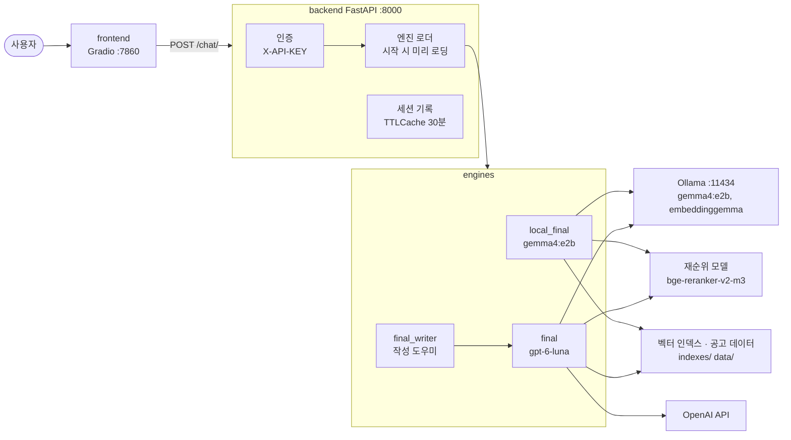
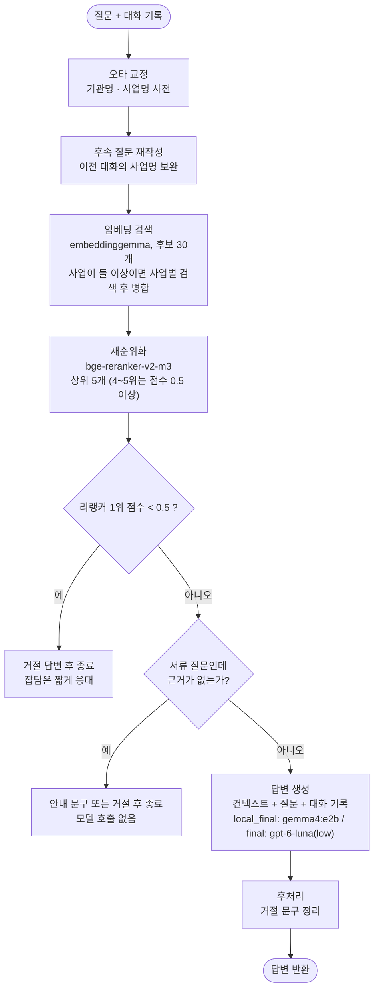

# 입찰메이트 (꾹꾹이 랩스)

공공 입찰 공고문(RFP)에 질문하면 공고 내용을 근거로 답하는 RAG 시스템입니다. (코드잇 AI 엔지니어 과정 중급 프로젝트)
B2G 입찰지원 컨설팅 스타트업 '입찰메이트'의 사내 도구를 가정했습니다.

- **입력**: 컨설턴트의 질문 (후속 질문 포함)
- **출력**: 공고 원문에 근거한 답변. 공고에 없는 내용은 정보가 없다고 답합니다.
- **데이터**: 공고 문서 100건 (HWP 96, PDF 4). 본문이 같은 2쌍을 합쳐 98건을 색인했습니다.
- **평가**: 골든셋 v2.2(74문항)로 단계별 실험을 하고, 정비한 v2.4(73문항)로 최종 성능을 검증했습니다. LLM 채점(gpt-5-nano)을 사용했습니다.
- **팀**: 꾹꾹이 랩스 (2팀) 6명 / 2026.11.09 ~ 11.30
- **최종 결과**: 정답률 **91.8%** · 환각률 **2.7%** · 거절 성공률 **100%** · 평균 응답 **1.83초** (고도화 + gpt-6-luna(low), v2.4 73문항 오타 포함 버전. 자세한 내용은 [실험 과정](#실험-과정))

실험 과정 · 분석 · 결론은 [최종 보고서(PDF)](docs/part3_2_ggukgguki_labs_report.pdf)에 정리되어 있습니다.


## 팀

<div>

### 꾹꾹이 랩스 (2팀)

|  |  |  |  |  |  |
|:---:|:---:|:---:|:---:|:---:|:---:|
| **[서동현](https://github.com/headache404)** | **[김건](https://github.com/9enius9un)** | **[김라희](https://github.com/KIMRAHUI)** | **[김주희](https://github.com/juhee4839)** | **[신재민](https://github.com/soul8327)** | **[이주엽](https://github.com/jylee10279)** |
| 팀장 · 리드 · 속도 개선 | Baseline · 모델 비교 | 엔진 고도화 · 작성 도우미 | 오타 강건성 · 프론트 | 청킹 · 검색 실험 | 백엔드 · 배포 |

</div>

| 이름 | 주요 작업 | 협업 일지 |
|---|---|---|
| 서동현 | Top-K 비교, 단계별 지연 분석, 프롬프트 개선, 워밍업 순서 | [협업 일지](https://app.notion.com/p/40f77fa64f7f803db89ffc7206703cc3?source=copy_link) |
| 김건 | 초기 Baseline 구축, 임베딩 6종과 로컬 · 클라우드 답변 모델 비교, v2.4 재검증 | [협업 일지](https://app.notion.com/p/40f77fa64f7f802c998fd9670e7efa66?source=copy_link) |
| 김라희 | 베이스라인 엔진 개선과 실험 (프롬프트 · 창 크기, 다중 사업 검색, 후보 수, 거절 문구, 금액 단위), 작성 도우미 | [협업 일지](https://app.notion.com/p/40f77fa64f7f80d29398f9eef19d229a?source=copy_link) |
| 김주희 | 오타 강건성 실험, 평가 지표 계획, 프론트 디자인 | [협업 일지](https://app.notion.com/p/40f77fa64f7f8051acddfd0718139e6d?source=copy_link) |
| 신재민 | 청크 크기 · 오버랩, 청킹과 검색 방식(Dense / BM25 / Hybrid) 비교, 골든셋 점검 | [협업 일지](https://app.notion.com/p/40f77fa64f7f80418065d1c7eef28a33?source=copy_link) |
| 이주엽 | FastAPI 백엔드와 인증, 엔진 연결, Docker Compose, GCP VM 배포 | [협업 일지](https://app.notion.com/p/40f77fa64f7f808c9718c92bb7b3d518?source=copy_link) |


## 목차

- [시스템 구조](#시스템-구조)
- [기술 스택](#기술-스택)
- [데이터와 전처리](#데이터와-전처리)
- [실험 과정](#실험-과정)
- [시작하기](#시작하기)
- [실행](#실행)
- [파일 구조](#파일-구조)
- [백엔드 API](#백엔드-api)
- [협업 방식](#협업-방식)
- [컨벤션](#컨벤션)
- [코드 스타일](#코드-스타일)
- [보고서 · 발표 자료](#보고서--발표-자료)

## 시스템 구조



| engine_id | 이름 | 설명 |
|---|---|---|
| `local_final` | 로컬 꾹꾹이 | Ollama 로컬 모델(gemma4:e2b) 답변 |
| `final` | 고성능 꾹꾹이 | OpenAI gpt-6-luna 답변 |
| `final_writer` | 작성 꾹꾹이 | 가이드 · 서식 · 검색 답변, Word 문서 생성 |

사용한 라이브러리는 [기술 스택](#기술-스택)에 정리했습니다.

### 질문 처리 흐름 (final · local_final)

두 엔진은 같은 파이프라인이고, 답변 모델과 실행 위치(provider)만 다릅니다.



- LangGraph로 만든 고정 파이프라인(retrieve → generate)입니다. 모델이 검색 도구를 직접 호출하는 에이전트 방식도 같은 질문으로 비교했고, 이번 데이터에서는 고정 파이프라인의 정답률이 더 높았습니다. (78.4% / 71.6%)
- 청크 앞에 `[기관 | 사업명 | 절]` 머리말을 붙였습니다.
- 여러 사업을 묻는 질문은 사업별로 나눠 검색한 뒤 합칩니다.

### 작성 도우미 흐름 (final_writer)


## 기술 스택

- Python `>=3.12`
- 패키지 관리: [uv](https://docs.astral.sh/uv/) (dependency groups 사용)

### 공통 (dependencies)

| 라이브러리 | 최소 버전 | 용도 |
|---|---|---|
| python-dotenv | 1.2.4 | `.env` 파일에서 환경 변수 로드 |

### preprocess: 데이터 전처리

| 라이브러리 | 최소 버전 | 용도 |
|---|---|---|
| pymupdf | 2.1 | PDF 텍스트, 이미지 추출 |
| olefile | 0.47 | OLE2 형식 파일(HWP, 구형 MS Office 등) 읽기 |
| pyarrow | 26.0.1 | Arrow/Parquet 형식 데이터 읽기, 쓰기 |
| tqdm | 4.70.1 | 진행률 표시 |

### backend: API 서버

| 라이브러리 | 최소 버전 | 용도 |
|---|---|---|
| fastapi | 0.162.0 | REST API 서버 프레임워크 |
| loguru | 0.7.3 | 로깅 |
| cachetools | 8.0.2 | 인메모리 캐시(TTL/LRU 등) |

### engines: RAG / 모델 엔진

| 라이브러리 | 최소 버전 | 용도 |
|---|---|---|
| langchain | 1.4.9 | LLM 애플리케이션 프레임워크 (LangGraph 포함, 검색과 답변 그래프 구성) |
| langchain-chroma | 1.1.0 | Chroma 벡터 DB 연결 |
| langchain-ollama | 1.1.0 | Ollama 로컬 모델(gemma4:e2b, embeddinggemma) 연결 |
| langchain-openai | 1.8.1 | OpenAI 모델(gpt-6-luna, 채점용 gpt-5-nano) 연결 |
| langchain-text-splitters | 1.1.3 | 문서 청킹 |
| pandas | 3.1.1 | 표 형식 데이터 처리 |
| numpy | 2.5.4 | 수치 계산 |
| torch | 2.14.1 | 딥러닝 프레임워크 (CUDA 13.0용 PyTorch 저장소에서 설치, `pyproject.toml`에 지정) |
| sentence-transformers | 6.3.0 | 텍스트 임베딩, 리랭킹 모델 |
| python-docx | 1.1.2 | Word(.docx) 문서 읽기, 쓰기 |

### hf: Hugging Face

| 라이브러리 | 최소 버전 | 용도 |
|---|---|---|
| huggingface_hub | 2.4.0 | Hugging Face Hub 모델 다운로드, 업로드 |

### frontend: UI

| 라이브러리 | 최소 버전 | 용도 |
|---|---|---|
| gradio | 6.31.0 | 웹 UI |
| httpx | 0.28.1 | 백엔드 API 호출용 HTTP 클라이언트 |

## 데이터와 전처리

- 공공 입찰 공고 문서 100건(HWP 96, PDF 4)을 사용했습니다. 발주 기관 87곳, 사업 금액 중앙값 약 1.7억 원이며, 문서당 표가 많아(중앙값 118개) 표를 온전히 변환하는 데 집중했습니다.
- HWP는 자체 변환기, PDF는 kordoc으로 변환하고, 그림 속 글자는 OCR로 보강했습니다. 본문이 같은 2쌍을 합쳐 98건을 색인했습니다.
- 성능은 직접 만든 골든셋(v2.4, 73문항)으로 평가했습니다.

> 변환, OCR, 정제, 청킹과 머리말, 골든셋 구성은 [데이터와 전처리](https://app.notion.com/p/42577fa64f7f8034afead5d4653195c7)에 정리했습니다.

## 실험 과정

### 최종 평가

같은 답변 모델(gpt-6-luna)에서 처음 만든 Baseline과 고도화한 엔진을 비교했습니다. 골든셋은 v2.4 73문항입니다.

| 지표 | Baseline | 고도화 | 목표 |
|---|---|---|---|
| 정답률 | 38.4% | **91.8%** | 70% 이상 |
| 환각률 | 16.4% | **2.7%** | 6% 이하 |
| 거절 성공률 | 54.5% | **100%** | 80% 이상 |
| 정답 문서 검색 성공률 | 69.4% | **96.8%** | 80% 이상 |
| 평균 응답 시간 | 1.79초 | **1.83초** | 2초 이하 |

- 답변 모델이 같으므로, 차이는 검색과 거절 처리 등 파이프라인 고도화의 효과입니다.
- 목표 지표를 모두 충족한 조합은 고도화 + luna였습니다. 로컬 모델로 고도화한 경우(고도화 + gemma)는 정답률 83.6%, 응답 시간 6.63초로 응답 시간이 목표를 넘었습니다.
- 위 값은 v2.4 73문항에 오타를 넣은 골든셋(`v24_typo_medium`) 기준입니다. 오타 없는 정상 질문(v24)에서 같은 조합은 평균 89.7%였습니다.

### 실험 분포

[](https://docs.google.com/spreadsheets/d/e/2PACX-1vQG78D2W8_Vgm00fcaufspqEPmnppqy--TrK6tlBtZlVU98vokcwpEI4B7aqLpfw-D6Uc8wdT4-JtEy/pubchart?oid=678058960&format=interactive)

이미지를 클릭하면 마우스를 올려 실험 메모를 볼 수 있는 인터랙티브 차트가 열립니다.

> 실험 원칙, 검색과 답변 개선, 모델 비교, 통합 엔진 스위치, 작성 도우미 평가, 한계는 [실험 과정](https://app.notion.com/p/42577fa64f7f80029e70ea4246b3c284)에 정리했습니다.

## 시작하기

```bash
git clone https://github.com/codeit-part3/codeit-part3-2.git
cd codeit-part3-2
uv sync                  # uv.lock 기준으로 팀원 전원이 같은 환경이 됩니다
uvx prek install         # 커밋 전 자동 검사 설치 (프로젝트마다 한 번)
cp .env.example .env     # 값을 채웁니다. .env는 절대 커밋하지 않습니다
```

> `cp`는 Git Bash · MSYS2에서 쓰는 명령입니다. **Windows PowerShell**에서는 `Copy-Item .env.example .env`를 쓰세요.

### 환경 규칙

| 대상 | 규칙 |
|---|---|
| 패키지 추가 | `uv add <패키지>` 로 추가하고 `uv.lock`도 **반드시 함께 커밋** (`pip` 사용 금지) |
| `.venv` | 직접 수정하지 않고, 올리지 않습니다 |
| `uv.lock` | 직접 수정하지 않고, **반드시 올립니다** |

### 환경 변수

`.env`에 넣는 값은 아래와 같습니다.

```
OPENAI_API_KEY=<팀 채널에서 전달받은 키>   # 답변 생성, 채점
OLLAMA_BASE_URL=<로컬 모델 서버 주소>
GROQ_API_KEY=<Groq로 채점할 때만>
X_API_KEY=<프론트 → 백엔드 인증 키>        # X-API-KEY 헤더 검증
SHEET_WEBHOOK_URL=<실험 기록 구글 시트 웹앱 URL>   # 팀 채팅으로 공유
SHEET_SECRET=<시트 비밀키>
EXPERIMENT_AUTHOR=<본인 이름>               # 실험 기록의 author 칸
```

### 데이터 준비

RFP 원본과 골든셋은 비밀유지 조항 때문에 저장소에 없습니다. 팀 비밀방에서 받아 아래 위치에 둡니다. (`data/`, `indexes/`는 git 제외)

```
data/
├─ clean_mixed_ocr_v2/      전처리된 공고 98건 + _meta.csv
└─ golden/                  골든셋
indexes/                    벡터 인덱스
```

```bash
uv run python -m ai.data_basic.check_data    # 받은 파일이 팀 기준과 같은지 확인
```

### 커밋 기록 보기 (선택)

처음 한 번 `git lg`를 등록해 두면 커밋 기록을 보기 편합니다.

```bash
git config --global alias.lg "log --color --graph --pretty=format:'%C(bold blue)%h%Creset -%C(bold green)%ad%Creset%C(red)%d%Creset %s %C(bold yellow)[%an]%Creset' --abbrev-commit --date=short --all"
```

## 실행

### Docker Compose

GPU가 있는 환경에서 한 번에 전체 서비스를 띄울 수 있습니다.

```bash
docker compose up -d --build
```

- 기동 순서: `ollama` → `ollama-pull` · `hf-pull`(모델 다운로드) → `backend`(`/health` 통과) → `frontend`
- 화면 http://localhost:7860 / 백엔드 http://localhost:8000

| 서비스 | 포트 | 역할 |
|---|---|---|
| frontend | 7860 | Gradio 화면 |
| backend | 8000 | FastAPI, 검색 · 재순위 파이프라인 |
| ollama | 11434 | gemma4:e2b, embeddinggemma 서빙 |
| ollama-pull | - | 모델 자동 다운로드 (초기화용) |
| hf-pull | - | 재순위 모델 사전 캐싱 |

| 볼륨 | 목적 |
|---|---|
| `ollama_data`, `hf_cache` | 모델 재다운로드 방지 |
| `data`, `indexes` | 데이터와 벡터 DB 영속화 |
| `guide_files` | 작성 도우미 가이드 캐시 보존 (공고별 생성에 1~2분이 걸려 재생성을 막음) |

backend 컨테이너는 오프라인 모드(`HF_HUB_OFFLINE=1`)로 실행해, 이미 내려받은 모델만 사용합니다.

### 평가

프로젝트 루트에서 실행하며, `data/`와 `indexes/`가 준비되어 있어야 합니다.

```bash
# 골든셋 형식 점검
uv run python -m ai.data_basic.golden_eval

# 엔진에 샘플 질문 실행 (결과는 outputs/에 csv로 저장)
uv run python -m engines.local_final.baseline     # 로컬 모델(gemma4:e2b)
uv run python -m engines.final.baseline           # OpenAI 모델(gpt-6-luna)
```

골든셋 전체 평가는 `evaluate.py`로 실행하며, 로컬 엔진(`engines/local_final`)을 평가합니다. 리랭커(bge-reranker-v2-m3), 거절 컷오프, 오타 교정은 `engines/local_final/config.py` 설정대로 적용되고, LLM 채점과 구글 시트 기록이 기본으로 켜져 있습니다.

```bash
# 빠른 확인 (5문항, 채점과 시트 기록 없음)
uv run python evaluate.py --limit 5 --no-judge

# 전체 평가 + 채점 + 시트 기록
uv run python evaluate.py --name <실험 이름> --memo "<한 줄 설명>"

# 에이전트 방식으로 비교
uv run python evaluate.py --engine agent --no-judge
```

- 모든 스크립트는 **프로젝트 루트**에서 실행합니다.
- 골든셋은 `config.py`의 `GOLDEN_FILE`(v2.4, 73문항)을 사용합니다.
- 결과는 `outputs/`에 문항별로 저장되고, 시트 기록에는 `.env`의 `SHEET_WEBHOOK_URL`, `SHEET_SECRET`, `EXPERIMENT_AUTHOR`가 필요합니다.
- 설정을 바꿔 비교할 때는 `engines/local_final/config.py`의 값(예: `RERANK`, `RERANK_POOL`, `TOP_K`)을 수정한 뒤 `--name`을 다르게 주고 실행합니다.

## 파일 구조

```
backend/          FastAPI 서버 (routes, services, schemas, config)
engines/          RAG 엔진 (final, local_final, final_writer)
frontend.py       Gradio 화면 (style.css, progress.css)
ai/data_basic/    변환(HWP/PDF), OCR, 전처리, EDA, 청킹·임베딩·재순위 비교, 골든셋 점검
scripts/typo/     오타 강건성 실험
common/           구글 시트 실험 기록
docs/             최종 보고서(PDF) · 발표 자료(PPTX)
data/             공고 · 골든셋 (git 제외, 비밀유지)
indexes/          벡터 인덱스 (git 제외)
outputs/          평가 결과 (git 제외)
.github/          이슈 · PR 템플릿, pre-commit 워크플로
```

| 파일 | 역할 |
|---|---|
| `backend/main.py` | app 정의, 라우터 연결, lifespan에서 엔진 웜업 |
| `backend/routes/chat.py` | `/chat/` 요청 처리 (엔진 로딩 → 기록 조회 → 응답 생성 → 기록 저장) |
| `backend/services/` | 엔진 로더, 세션 기록(TTLCache), API 키 인증 |
| `engines/final/`, `engines/local_final/` | `baseline.py`(검색 · 재순위 · 생성 그래프), `config.py`(설정), `query_fix.py`(오타 교정) |
| `engines/final_writer/` | 작성 도우미 (`baseline.py` 어댑터, `writer.py` 그래프) |
| `frontend.py` | Gradio 화면, 백엔드 `/chat/` 호출 |
| `evaluate.py` | 골든셋 평가 (규칙 지표 + LLM 채점 + 시트 기록) |
| `judge.py` | LLM 채점 (faithfulness, correctness 등) |
| `retrieval.py` | 검색 전용 평가 (hit rate, MRR, context hit) |
| `common/sheet_log.py` | 구글 시트로 실험 기록 전송 |
| `ai/data_basic/conversion/` | HWP · PDF → 텍스트 변환 |
| `ai/data_basic/ocr/` | 그림 속 글자 OCR과 품질 정리 |
| `ai/data_basic/preprocessing/` | 말뭉치 전처리, 청킹용 색인 |
| `ai/data_basic/analysis/` | 변환 커버리지 · EDA 통계 |
| `ai/data_basic/experiments/` | 청킹 · 임베딩 · 재순위 비교 실험 |
| `ai/data_basic/golden_eval.py` | 골든셋 점검과 답변 채점 |
| `scripts/typo/` | 오타 골든셋 생성과 강건성 측정 |
| `docs/` | 최종 보고서(PDF), 발표 자료(PPTX) |

## 백엔드 API

화면(Gradio)과 엔진(RAG 파이프라인) 사이에서 요청 검증, 대화 기록 관리, 엔진 호출, 응답 반환을 맡습니다. 기술 스택은 FastAPI와 loguru입니다.

| 메서드 | 경로 | 인증 | 설명 |
|---|---|---|---|
| POST | `/chat/` | `X-API-KEY` | 엔진 ID, 세션 ID, 질문을 받아 답변 반환 (비동기) |
| GET | `/health` | 없음 | 배포 직후 서버 상태 확인 |

```bash
curl -X POST http://localhost:8000/chat/ \
  -H "X-API-KEY: $X_API_KEY" -H "Content-Type: application/json" \
  -d '{"engine_id":"final","session_id":"<uuid>","message":"<질문>"}'
```

### 설계 결정

- **비동기 처리**: `/chat`과 엔진 호출을 `async/await`로 구현했습니다. 외부 API 응답처럼 대기 시간이 긴 작업 중에도 다른 요청을 받기 위해서입니다. 연산 시간이 긴 엔진 호출은 별도 쓰레드로 분리하고, 메모리만 다루는 세션 기록 조회 · 추가는 직접 호출합니다.
- **기동 시 엔진 사전 로딩과 웜업**: 서버 시작 시 엔진과 모델을 미리 로딩하고 짧은 질의로 웜업합니다. 첫 요청의 지연을 줄이고, 로딩이나 웜업에 실패하면 기동을 중단해 잘못된 상태로 서비스되는 것을 막습니다.
- **세션 관리**: 프론트가 탭마다 uuid를 만들어 보내고, 서버는 이를 키로 기록을 관리합니다. 기록은 TTLCache(500개, 마지막 대화 후 30분)에 저장해 자동 만료합니다. 갱신 구간에는 `threading.Lock`을 두고, 락 안에서는 긴 작업을 하지 않습니다.
- **엔진 인터페이스 통일**: 모든 엔진을 같은 호출 형태(`answer(message, history)`)로 맞춰, 엔진을 추가하거나 바꿔도 라우터 코드는 바꾸지 않습니다. 평가 스크립트와 화면이 같은 API를 쓰므로 실험 조건도 맞추기 쉽습니다.
- **인증**: 공유 키를 `X-API-KEY` 헤더로 받아 `/chat` 라우터의 의존성으로 검사합니다. `/health`는 키 없이 접근할 수 있습니다. 사용자별 구분은 되지 않고, 키가 유출되면 전체 재발급이 필요합니다.
- **오류 처리**: 실패 지점별로 상태 코드를 나눕니다. 로그는 loguru로 남기고, 클라이언트에는 원인을 노출하지 않는 짧은 메시지만 전달합니다.

| 단계 | 상태 코드 | 처리 |
|---|---|---|
| 요청 형식 오류 | 422 | FastAPI 자동 검증 |
| 인증 실패 | 401 | 키 불일치 |
| 엔진 미존재 | 404 | `engine_id` 검증 |
| 엔진 로딩 실패 | 503 | 로그 기록 후 응답 |
| 응답 생성 실패 | 500 | 로그 기록, 대화 기록 저장 생략 |

## 협업 방식

1. **이슈를 만든다.** 템플릿의 "작업할 내용"을 체크리스트로 적습니다.
2. **브랜치를 만든다.** `main`에서 새로 따고, `main`에는 직접 푸시하지 않습니다.
3. **작업하고 커밋한다.** 커밋하면 pre-commit이 자동으로 파일을 정리합니다. 커밋이 멈추면 정리된 파일을 다시 `git add` 하고 `git commit` 합니다.
4. **PR을 올린다.** 템플릿 체크리스트를 채우고, `pre-commit` 검사가 통과하면 머지합니다. 중요한 변경은 팀원 1명에게 확인을 요청한 뒤 머지합니다.

> **기본 습관**
> - 작업 시작 전 `git pull`, 완료 즉시 `git push`
> - 같은 파일을 수정해야 하면 팀 채팅에 먼저 알립니다

## 컨벤션

타입은 `feat` / `fix` / `chore` / `docs` / `refactor` / `eval` 6개입니다.

| 대상 | 형식 | 예시 |
|---|---|---|
| Branch | `타입/#이슈번호-작업내용` | `feat/#12-bm25-search`, `chore/#3-env-setup` |
| Commit | `타입: 작업 내용` | `feat: BM25 검색 추가` |
| Issue / PR | `[타입] 작업 내용` | `[Feat] BM25 검색 추가` |

## 코드 스타일

`.pre-commit-config.yaml`에 정리 규칙이 있고, 커밋할 때와 PR을 올릴 때 같은 검사가 돌아갑니다.
직접 돌려 보려면 `uvx prek run --all-files`.

## 보고서 · 발표 자료

| 자료 | 파일 |
|---|---|
| 최종 보고서 | [part3_2_ggukgguki_labs_report.pdf](docs/part3_2_ggukgguki_labs_report.pdf) |
| 최종 발표 | [part3_2_ggukgguki_labs_presentation.pptx](docs/part3_2_ggukgguki_labs_presentation.pptx) |
